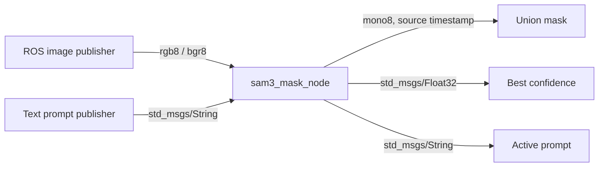

# sam3_ros

[](https://github.com/jackysqing-max/sam3_ros/actions/workflows/ci.yml)
[](LICENSE)

A reusable **ROS 2 SAM3 vision module**: send a text prompt and an RGB image stream,
receive a binary segmentation mask and confidence score. Extracted from
[vla_simu_workspace](https://github.com/jackysqing-max/vla_simu_workspace) into an
independent `ament_python` package. It runs without robot controllers, simulation,
benchmark tooling, or an LLM.

[Quick start guide](docs/quickstart.md) · [Deployment and Docker](docs/deployment.md) ·
[Topics, parameters, and QoS](docs/interfaces.md) · [Validation](docs/validation.md)



Features:

- Text-guided instance segmentation using Hugging Face `Sam3Model` / `Sam3Processor`.
- Bounded latest-frame queue; configurable inference rate; CPU or CUDA inference.
- Runtime prompt switching, with stale in-flight results discarded.
- Confidence filtering, bounded instance selection, and union of selected masks.
- Original image dimensions, timestamp, and frame ID preserved in the output mask.
- Local model paths, pinned model revisions, and offline loading.
- ROS launch/YAML, setup script, Docker deployment, a still-image publisher, and tests.

## Requirements

The validated baseline is **Ubuntu 22.04 + ROS 2 Humble + system Python 3.10**.
The model stack is PyTorch **2.10.0**, torchvision **0.25.0**, Transformers **5.2.0**,
NumPy **1.26.4**, and Pillow **12.1.1**. CUDA setup uses the PyTorch **cu128** wheels;
the NVIDIA driver must support those wheels. Other ROS distributions are untested.
CPU mode is available but GPU inference is recommended for live streams.

This integration uses Transformers rather than installing Meta's separate Python
package. The latter's Python requirements do not define this ROS wrapper's environment.
Model weights must be obtained separately through the gated
[facebook/sam3 model page](https://huggingface.co/facebook/sam3).

## Quick start

Install ROS 2 Humble first, then the required deployment tools:

```bash
sudo apt-get update
sudo apt-get install -y python3-venv python3-pip python3-colcon-common-extensions \
  ros-humble-launch-ros ros-humble-ament-index-python \
  ros-humble-sensor-msgs ros-humble-std-msgs

mkdir -p "$HOME/sam3_ws/src"
git clone https://github.com/jackysqing-max/sam3_ros.git "$HOME/sam3_ws/src/sam3_ros"
cd "$HOME/sam3_ws/src/sam3_ros"
./scripts/setup.sh cuda "$HOME/sam3_ws"  # use cpu for CPU-only wheels

source /opt/ros/humble/setup.bash
source "$HOME/sam3_ws/.venv/bin/activate"
source "$HOME/sam3_ws/install/local_setup.bash"
python scripts/check_environment.py
```

Request model access and accept its terms on Hugging Face, then authenticate and
download the Transformers model files. These commands require your own authorized account:

```bash
hf auth login
python scripts/download_model.py
ros2 launch sam3_ros sam3.launch.py \
  device:=cuda image_topic:=/camera/color/image_raw prompt:="red cup"
```

In a second terminal, source the same three environment files, then switch targets:

```bash
ros2 topic pub --once /sam3/prompt std_msgs/msg/String "{data: 'blue cup'}"
ros2 topic echo /sam3/score std_msgs/msg/Float32
```

The default image input is `/image_raw`; default outputs are `/sam3/mask`,
`/sam3/score`, and `/sam3/active_prompt`. Change topics through launch arguments
or [config/sam3.yaml](config/sam3.yaml). Parameters are startup settings;
change the live target through the prompt topic.

For a deployment with no network at runtime:

```bash
python scripts/download_model.py --output "$HOME/models/sam3"
ros2 launch sam3_ros sam3.launch.py \
  model_id:="$HOME/models/sam3" local_files_only:=true device:=cuda
```

## Camera-free demo and verification

After sourcing the environment, use any local image with the extra publisher:

```bash
ros2 run sam3_ros sam3_image_file_node --ros-args -p image_path:=/absolute/path/image.jpg
# Another terminal:
ros2 launch sam3_ros sam3.launch.py device:=cuda prompt:="red cup"
```

Run a real ROS/model smoke test using synthetic shapes, with no external image files:

```bash
python scripts/smoke_test.py --device cuda --local-files-only --require-mask
```

The smoke test launches the installed package in ROS domain **97** (override with
`--domain-id`), sends padded BGR images, checks mask encoding/dimensions/headers and
scores, switches a prompt using ordinary volatile QoS, then stops its own processes.
Omit `--require-mask` to check transport without requiring recognition of both shapes.

Unit tests do not require ROS, CUDA, or model weights:

```bash
python -m pip install numpy==1.26.4 Pillow==12.1.1 -r requirements-test.txt
python -m pytest -q
```

## Using it in another ROS workspace

Clone this repository as a package under `src/`, install the model dependencies into
a system-compatible venv, and build with that interpreter:

```bash
source /opt/ros/humble/setup.bash
source /path/to/compatible/venv/bin/activate
cd /path/to/your_ws
python -m colcon build --symlink-install --packages-select sam3_ros
source install/local_setup.bash
ros2 launch sam3_ros sam3.launch.py device:=cuda image_topic:=/your_camera/image_raw
```

Using `python -m colcon` matters: node shebangs must point to the interpreter that
contains Torch and Transformers. Use ROS's Python ABI (3.10 for the validated Humble
baseline) and `--system-site-packages`; a Python 3.12 Conda environment cannot import
the Humble Python 3.10 `rclpy` extension.

The output mask combines selected instances into one foreground mask. `/sam3/score`
reports the best model score even when every instance is below the mask threshold.
Consumers needing 3D targets can pair the mask with aligned depth using the source
image timestamp. Instance IDs, video tracking, depth fusion, and robot control are
outside this package's current interface.

## License and attribution

The ROS integration is **Apache-2.0**; see [LICENSE](LICENSE) and [NOTICE](NOTICE).
SAM3 weights and Meta's official model code have their own
[SAM License](https://github.com/facebookresearch/sam3/blob/main/LICENSE) and access
terms. This repository distributes the ROS wrapper, not model weights, credentials,
recordings, or datasets. This is an independent community integration.

Upstream technical references:
[Transformers SAM3 documentation](https://huggingface.co/docs/transformers/en/model_doc/sam3),
[Meta SAM3](https://github.com/facebookresearch/sam3),
[ROS 2 Humble](https://docs.ros.org/en/humble/index.html).
